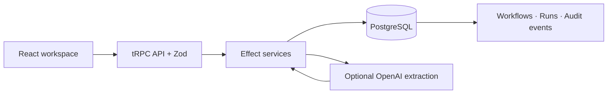

# FlowState

**A workspace to create workflows, run them, review document intake, and track every decision.**

[**Live dashboard ↗**](https://flowstate-steel-psi.vercel.app) · [CI status](https://github.com/FarnazNK/FlowState/actions/workflows/ci.yml) · [API health](https://flowstate-steel-psi.vercel.app/api/healthz)

[](https://github.com/FarnazNK/FlowState/actions/workflows/ci.yml)


## What you can do

1. **Create** a workflow and activate it.
2. **Launch** an execution and advance it through queued, running, approval, and terminal states.
3. **Review** an optional AI document extraction step on a running execution.
4. **Inspect** the audit timeline to see state transitions and extracted fields.

The dashboard includes workflow search, status filters, execution details, and incremental history loading. AI extraction requires a configured server-side API key; the other workflow features do not.

## How it works



- **Consistent state:** conditional updates reject stale execution transitions; updates and audit events are written in the same transaction.
- **Bounded data access:** workflow and run lists use keyset pagination, server-side workflow search uses a PostgreSQL full-text index, and audit events load in batches of 50.
- **Typed boundaries:** React consumes tRPC contracts; Zod validates inputs and extracted AI output.
- **Quality checks:** GitHub Actions runs TypeScript/Vite build, Vitest, and Docker build on pushes and pull requests.

## Run locally

Requires Node.js 20+ and Docker.

```bash
npm install
docker compose up -d db
cp .env.example .env
npm run dev
```

Set `DATABASE_URL` in `.env`. Set `OPENAI_API_KEY` only if using AI intake; `OPENAI_MODEL` optionally changes the model. Keep secrets on the server.

```bash
npm run build
npm test
npm run bench:db
```

The read-only benchmark measures database query latency percentiles and throughput from your execution environment. See [the benchmark script](scripts/benchmark.mjs) and [database schema](sql/schema.sql).

## Current boundaries

This is an interactive workflow console, **not yet a multi-tenant production service**. Authentication, tenant isolation, rate limiting, durable workers, and load testing at representative scale are still required. AI intake is optional and should be used with non-sensitive sample content. Previous database measurements used just four workflows, four runs, and five events; they do not demonstrate million-user capacity.
