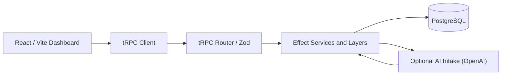
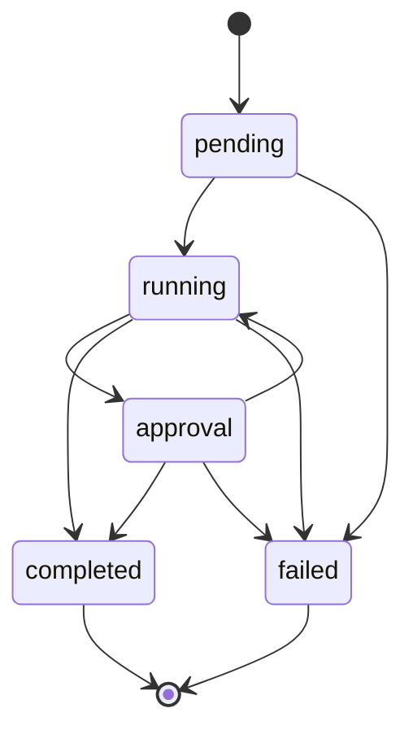
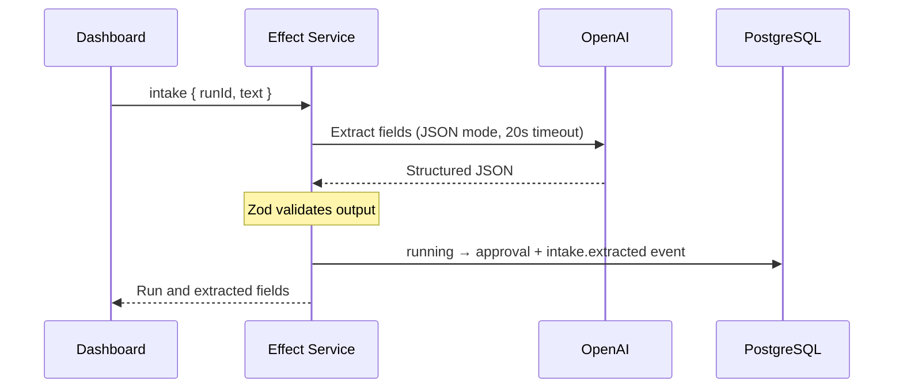

# FlowState — Workflow Operations Console

[](https://github.com/FarnazNK/FlowState/actions/workflows/ci.yml)
[](https://flowstate-steel-psi.vercel.app)

**Create workflows, run them, inspect every state change, and review AI-extracted document fields in one workspace.**

[Open dashboard](https://flowstate-steel-psi.vercel.app) · [API health](https://flowstate-steel-psi.vercel.app/api/healthz)

## Features

- **Workflows:** create (starts as `draft`), activate, and search. Only active workflows can start runs.
- **Runs:** start, advance through the state machine, and inspect the event timeline. `completed` and `failed` are terminal.
- **Document intake:** on a `running` run, paste sample text and extract structured fields with OpenAI. The result is saved to the timeline and the run moves to `approval`.
- **Audit trail:** every state change writes an event in the same PostgreSQL transaction; stale concurrent updates are rejected.

**Scope:** no authentication — approvals are manual state changes. Use sample data only.

## Technology stack

### Frontend


### Backend & database


### AI, testing & delivery


## Architecture



The router runs as Vercel functions (`api/`) or as a single Node server (`src/server/index.ts`) that also serves the built frontend.

### Run state machine



### AI intake



Extracted fields: `documentType`, `counterparty`, `effectiveDate` (ISO or `null`), `summary`, `risks` (max 6). Invalid model output is rejected, not stored.

## API

Procedures are served at `/trpc/<name>`.

| Procedure | Input | Notes |
| --- | --- | --- |
| `workflows` | — | Latest 100; ordered by creation time and ID |
| `createWorkflow` | `{ name }` | Created as `draft` |
| `activateWorkflow` | `{ id }` | |
| `runs` | `{ workflowId }` | Latest 100 for one workflow |
| `startRun` | `{ workflowId }` | Active workflows only |
| `events` | `{ runId, before? }` | Newest 50 events; use an event ID cursor to load older history |
| `transition` | `{ runId, expected, next }` | `CONFLICT` if disallowed or stale |
| `intake` | `{ runId, text }` | 40–12,000 chars; run must be `running` |

## Performance and scalability

FlowState keeps UI work and database reads bounded as execution histories grow:

- **Event-history pagination:** `events({ runId, before? })` fetches up to 50 events in descending event ID order. The dashboard offers **Load older events** to request the next page, rather than loading an entire audit history at once.
- **Fewer network round trips:** successful create and activate actions update local workflow state; run transitions refresh only the affected runs and timeline, concurrently. Manual refresh requests independent datasets in parallel.
- **Less rendering work:** dashboard counts use memoized derived values, dates share one `Intl.DateTimeFormat` instance, and event payload previews are truncated to 500 characters.
- **Targeted SQL:** list and event queries project explicit columns rather than `SELECT *`. Composite indexes support workflow ordering, runs by workflow and creation time, and audit events by run and ID.
- **Caching:** the standalone Node server caches built assets and sets immutable cache headers for fingerprinted assets. The Vercel health handler briefly caches database readiness results to reduce repeated probes.

These are implementation changes, **not benchmarked speedup claims**. Workflow and run listings still return at most 100 records; pagination for those lists remains future work.

## Run locally

Requires Node.js 20+ and Docker.

```bash
npm install
docker compose up -d db      # Postgres with sql/schema.sql applied
cp .env.example .env
npm run dev
```

| Variable | Required | Default |
| --- | --- | --- |
| `DATABASE_URL` | yes | — |
| `PORT` | no | `3001` |
| `OPENAI_API_KEY` | for AI intake | — |
| `OPENAI_MODEL` | no | `gpt-4o-mini` |

Keep `OPENAI_API_KEY` server-side only. Without it, everything except intake still works.

## Build, test, deploy

```bash
npm run build
npm test
docker compose up --build
```

CI runs the build, tests, and Docker build on every push and PR. On Vercel, set the env vars and apply `sql/schema.sql` to the database once.

## Roadmap

Authentication and approval policies, workflow/run list pagination, pausing workflows, worker queues, retries, rate limits, migrations, metrics, performance benchmarks, and end-to-end tests.
