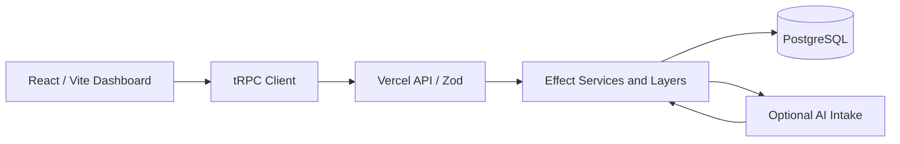
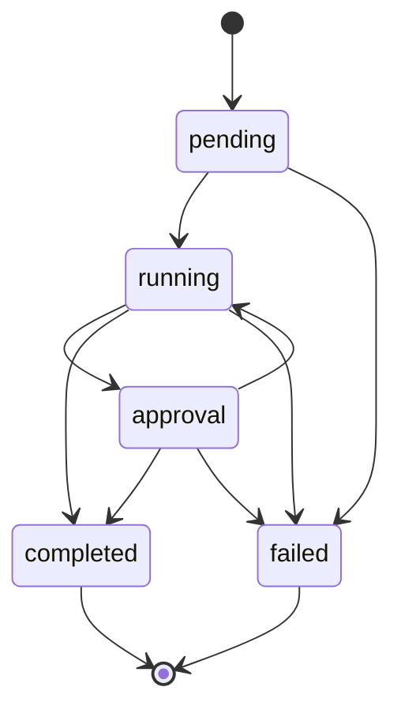
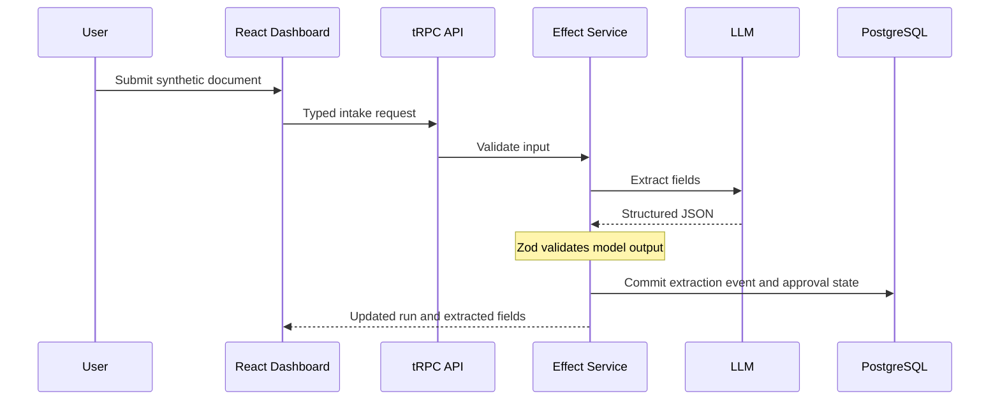

# FlowState — Workflow Operations Console

[](https://github.com/FarnazNK/FlowState/actions/workflows/ci.yml)
[](https://flowstate-steel-psi.vercel.app)

**Create workflows, run them, inspect every state change, and review extracted document fields in one operational workspace.**

[Open dashboard](https://flowstate-steel-psi.vercel.app) · [Source code](src/) · [API health](https://flowstate-steel-psi.vercel.app/api/healthz) · [CI runs](https://github.com/FarnazNK/FlowState/actions/workflows/ci.yml)

## What you can do

- **Explore immediately:** four sample workflows in the database, with queued, running, approval, and completed runs.
- **Run a workflow:** create and activate workflows, start executions, advance or fail runs, and inspect the timeline.
- **Review document intake:** paste synthetic document content into a running execution, request field extraction from a configured LLM, and inspect schema-validated results before marking the run complete.
- **Audit changes:** each accepted state transition produces an event in the same PostgreSQL transaction; stale concurrent transitions are rejected.

**Current scope:** The workflow state machine and audit events are operational features. AI extraction requires `OPENAI_API_KEY`; approvals are manual state changes rather than authenticated sign-off.

## Technology stack

### Frontend


### Backend & database


### AI, testing & delivery


[](https://github.com/FarnazNK/FlowState/actions/workflows/ci.yml)

## Architecture



### Workflow state machine



### AI intake flow



## Run locally

Requires Node.js 20+ and Docker.

```bash
npm install
docker compose up -d db
cp .env.example .env
npm run dev
```

To enable real document extraction, add `OPENAI_API_KEY` to your local `.env`, or to Vercel as a **server-only** secret. `OPENAI_MODEL` is optional; its default is `gpt-4o-mini`. Without a key, workflow and audit features still work.

## Build, tests, and deployment

```bash
npm run build
npm test
docker compose up --build
```

The [GitHub Actions quality gate](.github/workflows/ci.yml) runs the TypeScript/Vite build, tests, and Docker build. The badge above reflects the actual workflow status rather than a hardcoded claim.

## Roadmap

Authenticated approval policies, durable worker queues, retry scheduling, rate limits, better operational metrics, and end-to-end browser tests. The current build is a workflow console, not an autonomous agent.
