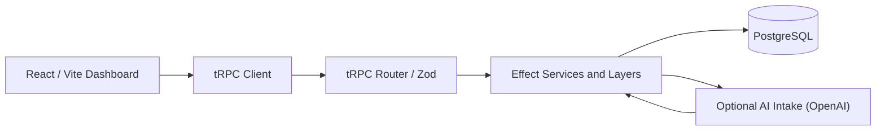
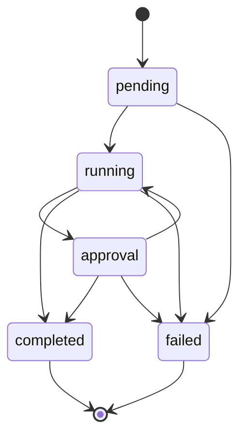
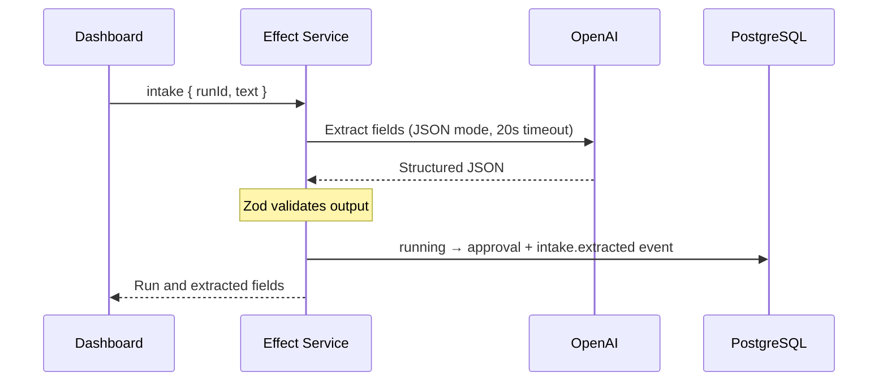

# FlowState — Workflow Operations Console

[](https://github.com/FarnazNK/FlowState/actions/workflows/ci.yml)
[](https://flowstate-steel-psi.vercel.app)

**Create workflows, run them, inspect every state change, and review AI-extracted document fields in one workspace.**

[Frontend — Live demo](https://flowstate-steel-psi.vercel.app) · [Backend — Live API health](https://flowstate-steel-psi.vercel.app/api/healthz) · [Live API documentation](https://flowstate-steel-psi.vercel.app/docs) · [API reference](docs/API.md)

## Features

- **Workflows:** create (starts as `draft`), activate, and search. Only active workflows can start runs.
- **Runs:** start, advance through the state machine, and inspect the event timeline. `completed` and `failed` are terminal.
- **Document intake:** on a `running` run, paste sample text and extract structured fields with OpenAI. The result is saved to the timeline and the run moves to `approval`.
- **Audit trail:** every state change writes an event in the same PostgreSQL transaction; stale concurrent updates are rejected.

**Scope:** no authentication — approvals are manual state changes. Use sample data only.

## Technology stack

### Frontend


### Backend & database


### AI, testing & delivery


## Architecture



The router runs as Vercel functions (`api/`) or as a single Node server (`src/server/index.ts`) that also serves the built frontend.

### Run state machine



### AI intake



Extracted fields: `documentType`, `counterparty`, `effectiveDate` (ISO or `null`), `summary`, `risks` (max 6). Invalid model output is rejected, not stored.

## API

Procedures are served at `/trpc/<name>`.

| Procedure | Input | Notes |
| --- | --- | --- |
| `workflows` | `{ limit?, cursor?, search?, status? }` | Cursor pages (default 25, max 50); indexed search |
| `createWorkflow` | `{ name }` | Created as `draft` |
| `activateWorkflow` | `{ id }` | |
| `runs` | `{ workflowId, limit?, cursor? }` | Cursor pages (default 25, max 50) |
| `startRun` | `{ workflowId }` | Active workflows only |
| `events` | `{ runId, before? }` | Newest 50 events; use an event ID cursor to load older history |
| `transition` | `{ runId, expected, next }` | `CONFLICT` if disallowed or stale |
| `intake` | `{ runId, text }` | 40–12,000 chars; run must be `running` |

## Performance and scalability

FlowState keeps UI work and database reads bounded as execution histories grow:

- **Event-history pagination:** `events({ runId, before? })` fetches up to 50 events in descending event ID order. The dashboard offers **Load older events** to request the next page, rather than loading an entire audit history at once.
- **Fewer network round trips:** successful create and activate actions update local workflow state; run transitions refresh only the affected runs and timeline, concurrently. Manual refresh requests independent datasets in parallel.
- **Less rendering work:** dashboard counts use memoized derived values, dates share one `Intl.DateTimeFormat` instance, and event payload previews are truncated to 500 characters.
- **Targeted SQL:** list and event queries project explicit columns rather than `SELECT *`. Composite indexes support workflow ordering, runs by workflow and creation time, and audit events by run and ID.
- **Caching:** the standalone Node server caches built assets and sets immutable cache headers for fingerprinted assets. The Vercel health handler briefly caches database readiness results to reduce repeated probes.

These improvements are not evidence of million-user throughput. Workflow and run lists support cursor-based pagination; `workflows` supports indexed server-side search.

## Performance and data access

FlowState limits work per request and avoids unnecessary UI refetching:

- **Cursor-based audit history:** `events` returns at most 50 records, newest first. The dashboard loads older records on demand with the exclusive `before` cursor; event history is not pulled into the browser all at once.
- **Indexed queries:** `run_events(run_id, id)`, `workflows(created_at DESC, id DESC)`, and `runs(workflow_id, created_at DESC, id DESC)` support the primary history and list access patterns. SQL schema updates are in [sql/schema.sql](sql/schema.sql).
- **Lean SQL projections:** repository list/detail queries select explicit columns rather than `SELECT *`.
- **Less network churn:** after mutations, the UI updates the relevant state or refreshes only affected data. Independent run/event requests are fetched in parallel where appropriate.
- **Lower render overhead:** derived dashboard counts are memoized, the date formatter is reused, and individual event payload previews are capped at 500 characters.
- **Lighter health and asset serving:** the Vercel health handler caches the database probe result for five seconds within a warm function instance. The standalone Node server uses long-lived caching for fingerprinted static assets and avoids repeated disk reads after the first load.

**Scaling boundary:** workflow and run listings now use keyset pagination; full-text search is backed by a PostgreSQL GIN index. The event cursor uses the sequence ID rather than timestamps, keeping history order stable. No measured latency or throughput improvement is claimed.

### Pagination contract

`workflows` and `runs` return `{ items, nextCursor }`. Supply the previous response's `nextCursor` to load the next page. A null cursor means no more results. Cursor ordering is deterministic by `created_at DESC, id DESC`. Changing filters resets pagination; workflow search uses PostgreSQL full-text token matching rather than substring matching.

These improvements reduce per-request data volume, but **do not establish capacity for millions of concurrent users**. That requires tenant-scoped authorization, load tests, capacity planning, rate limiting, job queues, database connection pooling, and production observability.

## Performance measurement

A reproducible, **read-only** PostgreSQL benchmark is available:

```bash
DATABASE_URL=... npm run bench:db
BENCH_SAMPLES=500 BENCH_CONCURRENCY=8 npm run bench:db
```

It warms each query, then reports p50/p95/p99/max client-observed query latency and achieved requests per second for workflow pages, workflow search, run pages, event pages and a simple health probe. Its output includes the dataset size and timestamp; compare results only with the same dataset, region, configuration and concurrency. It does not simulate authenticated users, writes, the frontend, AI inference, or distributed production traffic. **Do not run high-concurrency tests against shared production infrastructure without an agreed capacity window.**

### Baseline database query plans (2026-10-19)

Measured with PostgreSQL `EXPLAIN (ANALYZE, BUFFERS, FORMAT JSON)` against the existing Neon development dataset:

| Query | Rows returned | Database execution time |
| --- | ---: | ---: |
| Workflow page (limit 26) | 4 | 0.042 ms |
| Run page (limit 26) | 1 | 0.088 ms |
| Event page (limit 50) | 1 | 0.044 ms |

Dataset at measurement: **4 workflows, 4 runs, 5 events**. These figures are single-query server-side execution times, **not** p95 latency, browser response time, throughput, or evidence of million-user capacity. PostgreSQL can prefer a sequential scan/sort on tiny tables even when indexes exist. The benchmark script must be run in an environment that can connect to the database; no large-load result has been established.

## Run locally

Requires Node.js 20+ and Docker.

```bash
npm install
docker compose up -d db      # Postgres with sql/schema.sql applied
cp .env.example .env
npm run dev
```

| Variable | Required | Default |
| --- | --- | --- |
| `DATABASE_URL` | yes | — |
| `PORT` | no | `3001` |
| `OPENAI_API_KEY` | for AI intake | — |
| `OPENAI_MODEL` | no | `gpt-4o-mini` |

Keep `OPENAI_API_KEY` server-side only. Without it, everything except intake still works.

## Build, test, deploy

```bash
npm run build
npm test
docker compose up --build
```

CI runs the build, tests, and Docker build on every push and PR. On Vercel, set the env vars and apply `sql/schema.sql` to the database once.

## Roadmap

Authentication and approval policies, durable worker queues, retries, rate limits, migrations, metrics, representative load testing, and end-to-end tests.
