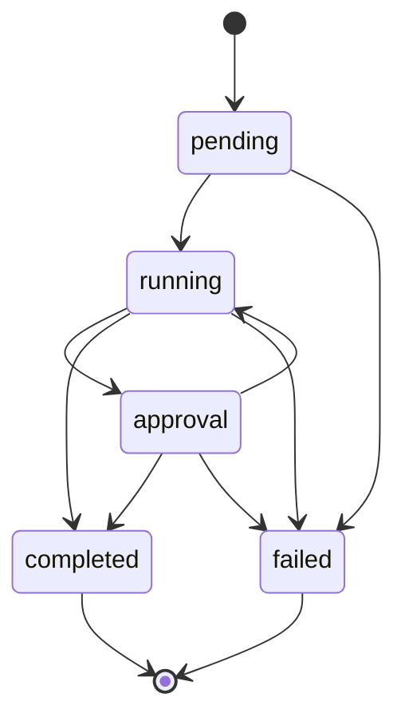

# FlowState API Reference

The FlowState backend is a **tRPC API**, not a conventional REST API or OpenAPI/Swagger service. The frontend shares its types with `AppRouter` in [src/server/router.ts](../src/server/router.ts). Inputs are validated with Zod.

**Live backend:** [API health](https://flowstate-steel-psi.vercel.app/api/healthz)  
**tRPC base URL:** `https://flowstate-steel-psi.vercel.app/trpc`

> The health endpoint reports database readiness. It does not document or exercise every tRPC procedure. The public demo currently has no authentication or tenant isolation: use sample data only.

## Procedures

| Procedure | Type | Input | Result |
| --- | --- | --- | --- |
| `workflows` | Query | `{ limit?, cursor?, search?, status? }` | `{ items: Workflow[], nextCursor }` |
| `createWorkflow` | Mutation | `{ name }` | New draft workflow |
| `activateWorkflow` | Mutation | `{ id }` | Active workflow |
| `runs` | Query | `{ workflowId, limit?, cursor? }` | `{ items: Run[], nextCursor }` |
| `startRun` | Mutation | `{ workflowId }` | New pending run, active workflows only |
| `events` | Query | `{ runId, before? }` | Up to 50 newest-first audit events |
| `transition` | Mutation | `{ runId, expected, next }` | Updated run |
| `intake` | Mutation | `{ runId, text }` | `{ run, extracted }` |

### Input rules

- `id`, `workflowId`, and `runId`: UUID strings.
- `name`: trimmed non-empty text, max 120 characters.
- `limit`: integer from 1 to 50; defaults to 25.
- `cursor`: `{ createdAt: ISO8601_datetime, id: UUID }` from the preceding page's `nextCursor`.
- `search`: optional trimmed query, max 120 characters; PostgreSQL full-text token matching.
- `status`: `draft`, `active`, or `paused`.
- `before`: optional positive integer event sequence ID (exclusive). Events are returned newest first.
- `text`: 40–12,000 characters; `intake` requires an execution in the `running` state and an OpenAI API key configured on the server.
- `expected` and `next`: `pending`, `running`, `approval`, `completed`, or `failed`.

### Pagination

For `workflows` and `runs`, request the first page without a cursor. Send `nextCursor` back for the next page. A `null` cursor means the list is complete. Both queries sort by `created_at DESC, id DESC`. When changing search or status, discard the old cursor and start again.

For `events`, use the ID of the oldest event in the current page as `before` to request earlier history.

## Typed TypeScript example

The recommended client is `@trpc/client`, so you don't need to hand-build the tRPC HTTP envelope.

```ts
import { createTRPCClient, httpBatchLink } from '@trpc/client';
import type { AppRouter } from '../src/server/router.js';

const api = createTRPCClient<AppRouter>({
  links: [httpBatchLink({ url: '/trpc' })],
});

const first = await api.workflows.query({ limit: 25, status: 'active' });
const second = first.nextCursor
  ? await api.workflows.query({ limit: 25, status: 'active', cursor: first.nextCursor })
  : null;

const runs = await api.runs.query({ workflowId: 'YOUR_WORKFLOW_UUID', limit: 25 });
const history = await api.events.query({ runId: 'YOUR_RUN_UUID' });
```

The TypeScript import shown above assumes a consumer inside this repository; external applications need their own shared router types.

## Run lifecycle



Transitions use optimistic concurrency: `expected` must match the stored current state. Both the transition and its audit event are committed in one PostgreSQL transaction. `completed` and `failed` are terminal states.

## Error handling

tRPC returns structured errors; these are the application-level codes explicitly mapped in the router:

| Code | Meaning |
| --- | --- |
| `BAD_REQUEST` | Input validation failed (tRPC/Zod) |
| `NOT_FOUND` | Requested workflow or active workflow does not exist |
| `CONFLICT` | Invalid or stale run transition |
| `PRECONDITION_FAILED` | AI model is not configured on the server |
| `BAD_GATEWAY` | AI extraction failed |
| `INTERNAL_SERVER_ERROR` | Database/storage operation failed |

The `/api/healthz` endpoint responds with JSON describing availability (`200` healthy or `503` unavailable); it is not an authentication or full integration test.

## Operational boundaries

Workflow/run lists and event pages are bounded to reduce payload sizes; supporting indexes are maintained in [sql/schema.sql](../sql/schema.sql). The current project does **not** implement authentication, tenant isolation, rate limiting, durable background queues, or verified million-user throughput. Those are necessary before exposing real customer data or deploying multi-tenant production workloads.
